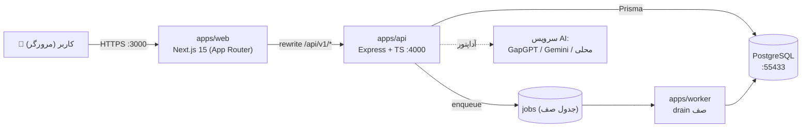
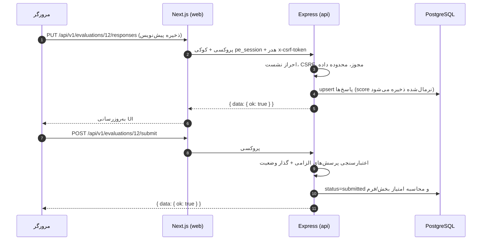
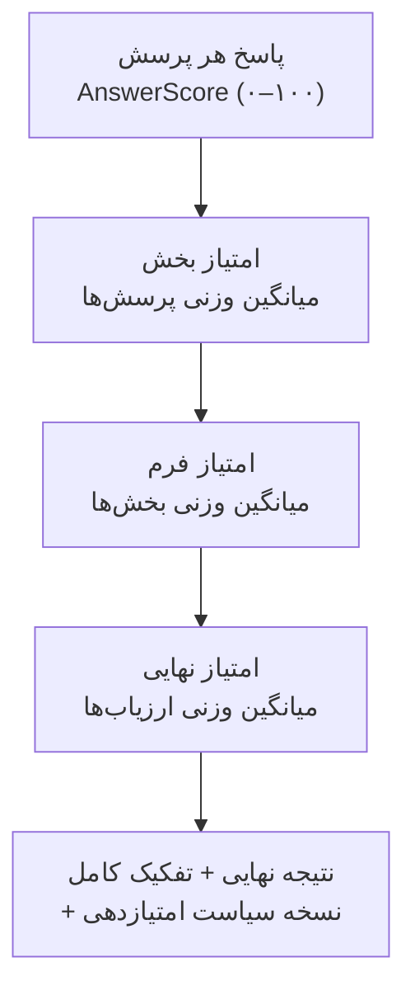

# فصل ۱ — معرفی و نمای کلی

> **یک‌خطی:** سامانه‌ای فارسی، راست‌به‌چپ و سازمانی که چرخه کامل ارزیابی عملکرد کارکنان — از طراحی پرسش و فرم تا ارزیابی، تأیید، انتشار نتایج، اعتراض و پیشنهاد جبران خدمات — را با امتیازدهی شفاف و قابل بازتولید اجرا می‌کند.

📍 بازگشت به [فهرست مطالب](./README.md)

---

## ۱.۱ این پروژه چیست و چه مشکلی را حل می‌کند

**مسئله:** سازمان‌ها عملکرد کارکنان را با فایل‌های اکسل پراکنده، ایمیل و فرم‌های کاغذی ارزیابی می‌کنند. نتیجه؟ امتیازها قابل بازتولید نیستند، دسترسی‌ها کنترل نمی‌شود (هر مدیری همه را می‌بیند)، سابقه تاریخی گم می‌شود و تصمیم‌های پاداش/ارتقا بدون مستندات شفاف گرفته می‌شود.

**راه‌حل:** یک سامانه یکپارچه که:

- پرسش‌ها، فرم‌ها و سیاست‌های امتیازدهی را **نسخه‌دار و تغییرناپذیر** می‌کند (ویرایش یک پرسش، نتیجه‌های گذشته را تغییر نمی‌دهد).
- امتیاز نهایی را **در سرور، وزن‌دار و مستند** محاسبه می‌کند و همیشه تفکیک «چرا این عدد به دست آمد» را نگه می‌دارد.
- دسترسی را **سمت سرور** بر اساس نقش و **رابطه سازمانی** (مدیر مستقیم، تاریخچه مدیریت) محدود می‌کند.
- گردش‌کار ارزیابی (خودارزیابی → مدیر → بررسی منابع انسانی → انتشار → اعتراض) را با **گذارهای وضعیت معتبرشده در سرور** اجرا می‌کند.
- گزارش‌های اکسل و نمودارهای تحلیلی، تیکت پشتیبانی، دستیار هوشمند (اختیاری) و یک چرخه کامل مدیریت عملکرد (فرایند، دوره، توافق‌نامه) ارائه می‌دهد.

### در یک جمله دقیق‌تر

> این پروژه یک **مونوریپو TypeScript** است با سه برنامه اجرایی (`web`, `api`, `worker`)، پایگاه‌داده **PostgreSQL** از طریق **Prisma**، و بسته‌های مشترک؛ که «ارزیابی عملکرد» را از یک فعالیت دستی به یک **فرایند قابل حسابرسی** تبدیل می‌کند.

---

## ۱.۲ ویژگی‌های کلیدی

**🧩 داده و مدل‌سازی**
- ۶۳ مدل داده با کلیدهای خارجی، محدودیت یکتایی و ایندکس‌های صریح.
- جداسازی «هویت» از «پاسخ محرمانه» برای ارزیابی ناشناس.
- تاریخ مؤثر برای واحد/سمت/مدیر (می‌دانیم یک کارمند در دوره قبل زیر نظر چه کسی بوده).

**🔐 امنیت و دسترسی**
- نشست **پایگاه‌داده‌محور** (حذف ردیف نشست = خروج فوری)، رمز با `bcrypt` (هزینه ۱۲).
- محافظت **CSRF** (الگوی double-submit) روی همه درخواست‌های تغییردهنده.
- کنترل دسترسی **RBAC** با کاتالوگ ۷۳ دسترسی + **محدودسازی داده** بر اساس ارتباط سازمانی.
- خواندن یک رکورد متعلق به سازمان دیگر → **۴۰۴** (نه ۴۰۳) تا وجود رکورد فاش نشود.
- کلید سرویس‌های هوش مصنوعی با **AES-256-GCM** رمزنگاری و هرگز به مرورگر فرستاده نمی‌شود.

**📊 امتیازدهی**
- موتور امتیازدهی **خالص و قطعی** (`packages/shared/src/scoring.ts`) با `decimal.js` (بدون خطای شناور).
- تمایز «صفر» از «بی‌پاسخ» و حالت جدا برای «مصداق ندارد».
- وزن ارزیاب غایب **به‌صورت خودکار بازتوزیع نمی‌شود**.

**🗣 فارسی‌بودن و دسترس‌پذیری**
- تمام UI فارسی و `dir="rtl"`، قلم **وزیرمتن**، تاریخ **شمسی (جلالی)**، ارقام فارسی.
- هدف **WCAG 2.2 AA**: کنتراست، پیمایش با صفحه‌کلید، برچسب فرم، احترام به `prefers-reduced-motion`.

**📈 گزارش و خروجی**
- خروجی اکسل چند‌شیتی با محافظت در برابر **تزریق فرمول**، و دانلود کنترل‌شده با انقضا.
- خروجی «پاسخ‌های کاربران به تفکیک فرد» فقط برای مدیر ارشد.
- نمودارهای توزیع امتیاز و میانگین به تفکیک واحد و سمت.

**🧠 هوش مصنوعی (اختیاری)**
- لایه آداپتور (سازگار با OpenAI / Gemini / محلی)؛ پیش‌فرض هیچ داده ارزیابی شخصی ارسال نمی‌شود.

**📚 آموزش درون‌برنامه**
- مرکز راهنما، تورهای تعاملی گام‌به‌گام، و پیام‌های شناور راهنما.

---

## ۱.۳ دیاگرام معماری سطح بالا (Mermaid)

### ۱.۳.۱ نمای کلی برنامه‌ها



> 💡 مرورگر **فقط** با مبدأ Next.js حرف می‌زند؛ `/api/v1/*` از طریق `next.config.mjs` به Express پروکسی می‌شود تا کوکی نشست **same-site** بماند. در تولید، پروکسی معکوس همین کار را می‌کند.

📎 مرجع کد: `apps/web/next.config.mjs`

```js
// apps/web/next.config.mjs — پروکسی مسیر API به سرویس Express
async rewrites() {
  return [{ source: '/api/v1/:path*', destination: `${API_URL}/api/v1/:path*` }];
}
```

### ۱.۳.۲ جریان یک درخواست (مثال: ارسال ارزیابی توسط مدیر)



### ۱.۳.۳ موتور امتیازدهی (قلب سامانه)



📎 مرجع کد: `packages/shared/src/scoring.ts`

```ts
// موتور امتیازدهی خالص (بدون I/O) — با Decimal برای پرهیز از خطای شناور
export function computeSectionScore(answers: QuestionAnswer[], policy: ScoringPolicy): SectionScore {
  let numerator = D(0);
  let denominator = D(0);

  for (const answer of answers) {
    const weight = D(answer.weight);

    if (answer.isNotApplicable) continue;      // «مصداق ندارد» هرگز صفر در نظر گرفته نمی‌شود
    if (!answer.answered || answer.score === null) continue; // «بی‌پاسخ» از مخرج حذف می‌شود

    numerator = numerator.plus(D(answer.score).times(weight));
    denominator = denominator.plus(weight);
  }

  const hasScore = denominator.gt(0);
  // اگر بخشی پاسخ قابل‌امتیاز نداشته باشد، null برمی‌گردد (نه صفر گمراه‌کننده)
  return { sectionId: answers[0]?.sectionId ?? '', score: hasScore ? roundTo(numerator.dividedBy(denominator), policy.rounding) : null, /* … */ };
}
```

> ⚠️ **هشدار:** فرانت‌اند هرگز منبع امتیاز نهایی نیست. فقط پیش‌نمایشِ محاسبه‌شده در سرور را نمایش می‌دهد.

---

## ۱.۴ مخاطبان هدف

| مخاطب | چه چیزی عایدش می‌شود |
|---|---|
| 🧑‍💼 **مدیر ارشد / مالک محصول** | دید یکپارچه به چرخه ارزیابی، شفافیت امتیازها، مستندات انطباق و حریم خصوصی |
| 🧑‍💻 **توسعه‌دهنده بک‌اند** | مرزهای ماژولی روشن، سرویس امتیازدهی خالص، الگوی صف کارها |
| 🎨 **توسعه‌دهنده فرانت‌اند** | ساختار App Router، کامپوننت‌های RTL، الگوی «سرور‌کامپوننت برای خواندن + کلاینت‌کامپوننت برای تعامل» |
| 🛠 **مدیر سیستم / DevOps** | نصب بدون Docker، پیکربندی محیطی، استقرار و پشتیبان‌گیری |
| 👤 **کاربر نهایی (کارمند/مدیر)** | راهنمای گام‌به‌گام در فصل‌های کاربری و مرکز راهنمای درون‌برنامه |
| ⚖️ **مسئول انطباق/حقوقی** | فهرست داده‌ها، سیاست‌ها و ریسک‌های باقی‌مانده (فصل ۷ و اسناد `docs/legal`) |

---

## 🧾 خلاصه فصل

سامانه‌ای مونوریپویی و فارسی برای مدیریت کامل چرخه ارزیابی عملکرد، با تأکید بر **امتیازدهی شفاف**، **کنترل دسترسی سمت‌سرور** و **تغییرناپذیری نسخه‌ها**؛ فصل بعد نحوه نصب و راه‌اندازی را گام‌به‌گام می‌گوید.

⬅️ [فهرست مطالب](./README.md) · ➡️ [فصل ۲ — پیش‌نیازها و نصب](./02-setup.md)
