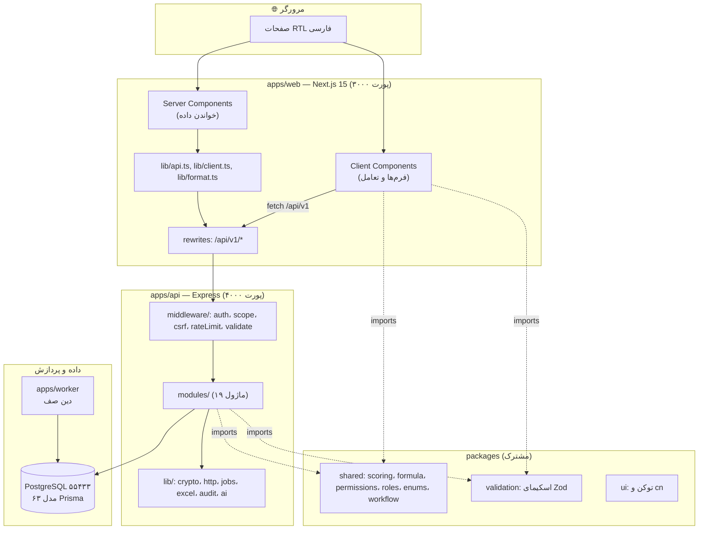
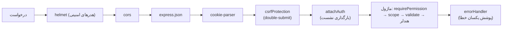
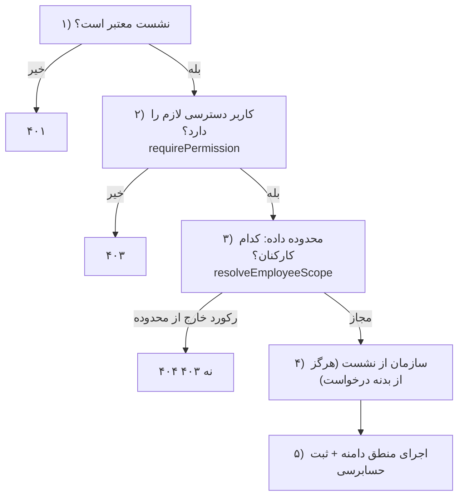
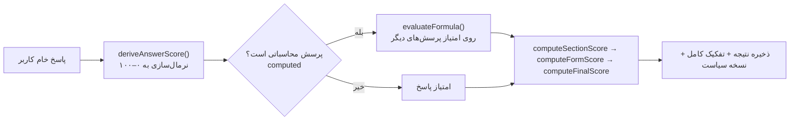
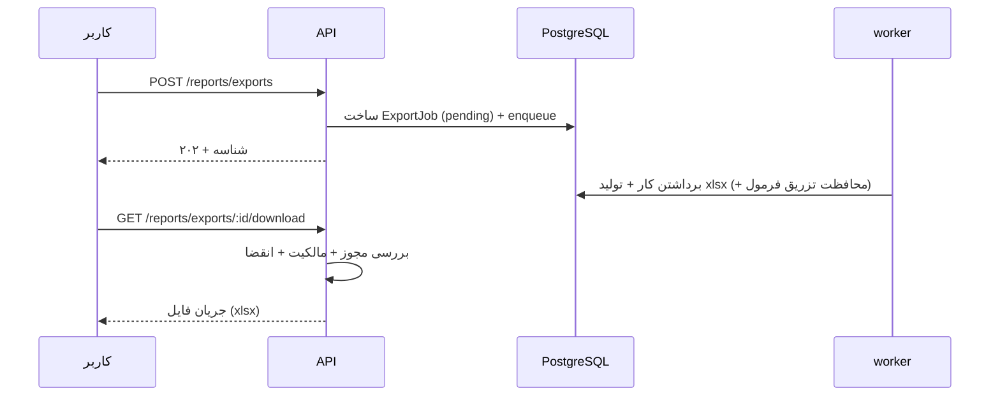

# فصل ۳ — معماری و ساختار

> **یک‌خطی:** معماری یک **مونوریپو مونولیت ماژولار** است: یک برنامه وب Next.js، یک سرویس Express با ۱۹ ماژول دامنه، یک ورکر، و بسته‌های مشترک — با مرزهای ماژولی روشن و «هسته خالص» قابل‌آزمون.

📍 بازگشت به [فهرست مطالب](./README.md)

---

## ۳.۱ دیاگرام کامل معماری

### ۳.۱.۱ نقشه برنامه‌ها و بسته‌ها



### ۳.۱.۲ چیدمان پوشه‌ها (فقط موارد مهم)

```text
performance-evaluation/
├── apps/
│   ├── api/            # سرویس Express
│   │   └── src/{app.ts, index.ts, config.ts, db.ts, middleware/, lib/, modules/}
│   ├── web/            # Next.js (App Router)
│   │   └── src/{app/, components/, lib/, styles/}
│   └── worker/         # دین صف کارها
├── packages/
│   ├── shared/         # هسته خالص: امتیازدهی، فرمول، دسترسی‌ها، enums، workflow
│   ├── validation/     # اسکیماهای Zod مشترک
│   └── ui/             # توکن‌های طراحی و `cn`
├── database/
│   ├── schema.prisma   # ۶۳ مدل
│   ├── migrations/     # ۳ مهاجرت
│   └── seeds/seed.ts   # داده اولیه
├── scripts/            # dev.cjs، postinstall.cjs، verify.cjs
├── tests/unit/         # تست‌های واحد (vitest)
├── docs/               # همین مستندات + اسناد امنیت/حقوقی
└── storage/            # فایل‌های خروجی گزارش‌ها (خارج از public)
```

---

## ۳.۲ لایه‌ها، ماژول‌ها و مسئولیت‌ها

### ۳.۲.۱ سرویس API (`apps/api`)

**لایه‌بندی صریح:**

| لایه | مسیر | مسئولیت |
|---|---|---|
| پیکربندی | `src/config.ts` | خواندن `.env` (ریشه) و اعتبارسنجی با Zod؛ شکست سریع در بوت |
| دسترسی داده | `src/db.ts` | کلاینت Prisma (تک‌نمونه) |
| میانی | `src/middleware/` | احراز هویت، محدوده داده، CSRF، نرخ‌محدودسازی، اعتبارسنجی |
| دامنه | `src/modules/*` | منطق هر قلمرو (۱۹ ماژول) |
| زیرساخت | `src/lib/` | رمزنگاری، پوشش خطا، صف، اکسل، حسابرسی، آداپتور AI |

**۱۹ ماژول دامنه:**

| ماژول | تمرکز |
|---|---|
| `auth` | ورود/خروج، نشست، بازیابی رمز، MFA، پروفایل، رضایت، تور |
| `users` | کاربران، بازنشانی رمز، حذف، دپارتمان، نقش |
| `roles` | نقش‌ها و کاتالوگ دسترسی‌ها |
| `organization` | واحدها و سمت‌ها |
| `employees` | کارکنان و تاریخچه مدیریت |
| `questions` | بانک پرسش + نسخه‌های تغییرناپذیر |
| `forms` | فرم‌ها، نسخه‌ها، بخش‌ها، پیش‌نمایش امتیاز |
| `cycles` | دوره‌ها، ارجاع‌ها، زمان‌بندی مراحل، داشبورد |
| `evaluations` | پاسخ‌ها، ارسال، بررسی، انتشار، نتایج، اعتراض‌ها، برنامه بهبود |
| `compensation` | سیاست‌ها، پیشنهادها، تأییدها |
| `processes` | فرایند مدیریت عملکرد (مراحل و ابعاد) |
| `agreements` | توافق‌نامه‌های عملکرد و شاخص‌ها |
| `reports` | خروجی اکسل، ورود اکسل، تحلیل نموداری |
| `ai` | سرویس‌های AI، مدل‌ها، گفتگو، مصرف |
| `help` | مقالات، پرسش‌های متداول، واژه‌نامه |
| `tickets` | پیام‌ها و تیکت‌های پشتیبانی |
| `admin` | تنظیمات، انطباق، سرویس‌های ثالث، دارایی‌ها، حسابرسی، امنیت |
| `jobs` | درین صف (با توکن bearer) |
| `health` | سلامت + پیکربندی عمومی PWA |

### ۳.۲.۲ برنامه وب (`apps/web`)

| بخش | مسئولیت |
|---|---|
| `src/app/` | ۳۴ صفحه؛ گروه `(app)` پوسته احرازشده، بقیه عمومی (ورود، حریم خصوصی…) |
| `src/components/` | ۲۹ کامپوننت؛ `ui.tsx` پایه‌ها، بقیه فرم/جدول/نمودار |
| `src/lib/api.ts` | کلاینت **سمت سرور** (فوروارد کوکی به API) |
| `src/lib/client.ts` | کلاینت **مرورگر** (با هدر `x-csrf-token`) |
| `src/lib/format.ts` | ارقام فارسی، تاریخ شمسی، پول، برچسب وضعیت |

**الگوی ثابت صفحات:** سرور‌کامپوننت داده را می‌خواند، کلاینت‌کامپوننت تعامل را می‌برد.

```tsx
// الگوی نمونه: صفحه = سرور (خواندن) + فرم = کلاینت (تعامل)
// src/app/(app)/admin/users/page.tsx  (Server Component)
export default async function AdminUsersPage() {
  const me = await getSession();                                   // خواندن نشست
  const users = await apiData<{ items: UserItem[] }>('/users');     // خواندن داده
  return <><Card>{/* جدول */}</Card><UserRowActions user={u} isSelf={u.id === me?.id} /></>;
}
```

> ⚠️ **قاعده RSC:** نمی‌توان یک **تابع** را از سرور‌کامپوننت به کلاینت‌کامپوننت پاس داد. به همین دلیل به‌جای `render={...}` از کامپوننت‌های ردیفی (`UserRowActions`) استفاده می‌شود که فقط props **سریال‌پذیر** می‌گیرند.

### ۳.۲.۳ بسته‌های مشترک

| بسته | چه دارد | چرا جدا است |
|---|---|---|
| `packages/shared` | `scoring.ts`، `formula.ts`، `permissions.ts`، `roles.ts`، `enums.ts`، `workflow.ts` | «هسته خالص» بدون I/O → قابل تست و قابل استفاده در هر دو طرف |
| `packages/validation` | اسکیماهای Zod | یک قاعده اعتبارسنجی، دو مصرف‌کننده (سرور و کلاینت) |
| `packages/ui` | توکن‌ها و `cn` | یکسان‌سازی ظاهر |

### ۳.۲.۴ ورکر (`apps/worker`)

```ts
// apps/worker/src/index.ts — حلقه دین صف (با توضیح فارسی)
import { runDueJobs, requeueStalledJobs, config } from '@pe/api/worker';

// هر ۵ ثانیه: ابتدا کارهای «قفل‌شده ولی رهاشده» را برمی‌گردانیم، سپس کارهای سررسیدشده را اجرا می‌کنیم
const requeued = await requeueStalledJobs();
const result = await runDueJobs(workerId, 25);   // حداکثر ۲۵ کار در هر تیک
```

> 💡 ورکر به **Redis نیاز ندارد**؛ صف یک جدول `jobs` در همان PostgreSQL است و با `SELECT … FOR UPDATE SKIP LOCKED` قفل می‌شود.

---

## ۳.۳ جریان داده از ورودی تا خروجی

### ۳.۳.۱ خط لوله میانی (هر درخواست API)



📎 کد: `apps/api/src/app.ts`

```ts
app.use(csrfProtection);   // همه درخواست‌های تغییردهنده به‌جز مسیرهای bearer/وب‌هوک
app.use(attachAuth);       // resolve نشست یک‌بار برای همه مسیرها
api.use('/users', usersRouter);
api.use('/evaluations', evaluationsRouter);
// …
app.use(errorHandler);     // تنها جایی که خطا به پاسخ تبدیل می‌شود
```

### ۳.۳.۲ خط لوله مجوزدهی (Authorization)



> 📌 سه اصل: (۱) سازمان همیشه از نشست؛ (۲) مدیر فقط کارکنانِ مرتبط با خودش؛ (۳) id سازمان دیگر → ۴۰۴ تا وجود رکورد فاش نشود.

### ۳.۳.۳ خط لوله امتیازدهی



### ۳.۳.۴ خط لوله خروجی گزارش



---

## ۳.۴ الگوهای طراحی به‌کاررفته

| الگو | کجا | فایده |
|---|---|---|
| **مونولیت ماژولار** | `apps/api/src/modules/*` | مرز روشن؛ در آینده می‌توان یک ماژول را جدا مقیاس داد |
| **هسته خالص (Functional Core)** | `packages/shared/scoring.ts`, `formula.ts` | منطق حیاتی بدون I/O → تست‌پذیر و بازتولیدپذیر |
| **آداپتور (Ports & Adapters)** | `apps/api/src/lib/ai/adapters.ts` | تعویض سرویس هوش مصنوعی بدون تغییر سایر بخش‌ها |
| **میانی‌افزار خط لوله‌ای** | `middleware/*` | امنیت و مجوزدهی در یک مسیر مشخص و قابل‌ردیابی |
| **نسخه‌گذاری تغییرناپذیر** | `question_versions`, `form_versions` | نتیجه تاریخی با ویرایش پرسش عوض نمی‌شود |
| **حسابرسی فققط‌افزودنی (Append-only)** | `audit_logs` | قابلیت ردیابی؛ بازنویسی نمی‌شود |
| **صف پایگاه‌داده‌ای** | جدول `jobs` + `SKIP LOCKED` | دوام بدون نیاز به Redis |
| **BFF با بازنویسی** | `next.config.mjs` rewrites | کوکی same-site؛ مرورگر بدون CORS |
| **دروازه پیکربندی (Config Gate)** | `config.ts` + `public/config` | متغیر نامعتبر = شکست در بوت، نه در میانه درخواست |

> 💡 **چرا مونولیت، نه میکروسرویس؟** دامنه به‌شدت درهم‌تنیده است (ارزیابی ↔ فرم ↔ امتیاز ↔ جبران خدمات) و یک سازمان را هدف گرفته؛ مونولیت ماژولار هزینه عملیاتی کمتری دارد و مرزها را برای جداسازی آینده حفظ می‌کند.

---

## ۳.۵ وابستگی‌های خارجی و فلسفه انتخاب

| وابستگی | چرا انتخاب شد | جایگزین رد‌شده |
|---|---|---|
| **PostgreSQL** | نیاز به تراکنش، `Decimal` دقیق، ایندکس و پرس‌وجوی رابطه‌ای | SQLite (برای این حجم و دقت کافی نیست) |
| **Prisma** | مهاجرت‌های نسخه‌دار، تایپ‌های تولیدی، تراکنش | کوئری خام (تایپ‌ناامن) |
| **Express** | بالغ، پایدار، اکوسیستم میانی‌افزار غنی | Fastify/Nest (هزینه بازنویسی) |
| **Next.js App Router** | رندر سمت سرور + پروکسی هم‌مبدأ | SPA خالص (افشای توکن در مرورگر) |
| **decimal.js** | دقت امتیاز بدون خطای شناور | `number` شناور (خطر خطای گردکردن) |
| **Zod** | یک اسکیما، دو مصرف‌کننده | اعتبارسنجی دستی دوگانه |
| **exceljs** | خروجی چندشیتی + کنترل سلول | CSV (بدون شیت و استایل) |
| **tests: Vitest** | سریع، سازگار با TS/ESM | Jest (سربار پیکربندی) |
| **صف جدولی** | بدون زیرساخت اضافه | Redis/BullMQ (نیاز به سرویس سوم) |

> ⚠️ **نکته صادقانه:** سرور GapGPT طبق مستندات موجود (یک SPA جاوااسکریپتی) **تأیید نشده** است؛ آداپتور آن به‌صورت قابل‌پیکربندی پیاده شده و تا ارائه کلید/مستندات واقعی «تنظیم‌نشده» می‌ماند. جزئیات در [فصل ۴.۵](./04-modules.md) و `docs/CHANGE-REPORT.md`.

---

## 🧾 خلاصه فصل

معماری، یک مونولیت ماژولار با مرزهای صریح است: `web` (رندر و تجربه)، `api` (دسترسی، مجوز، دامنه)، `worker` (پردازش پس‌زمینه)، و بسته‌های مشترک که منطق حیاتی را خالص و قابل‌تست نگه می‌دارند. فصل بعد هر ماژول را با مثال کد می‌شکافد.

⬅️ [فصل ۲ — نصب](./02-setup.md) · ➡️ [فصل ۴ — آموزش هر بخش](./04-modules.md)
