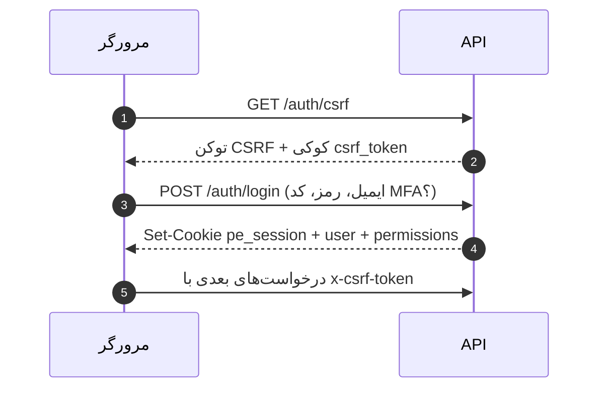

# فصل ۵ — مستندات رابط‌ها (API)

> **یک‌خطی:** همه‌ی ۱۹ ماژول از یک قاعده واحد پیروی می‌کنند: پیشوند `/api/v1`، پاسخ پوشش‌دار `{ data }` یا `{ error }`، مجوز اعلام‌شده در هر مسیر، و خطاهای استانداردشده.

📍 بازگشت به [فهرست مطالب](./README.md)

---

## ۵.۱ قواعد کلی

| موضوع | قاعده |
|---|---|
| پیشوند | `/api/v1` (در تولید پشت پروکسی معکوس) |
| پاسخ موفق | `{ "data": … }` با کد ۲۰۰/۲۰۱/۲۰۲ |
| پاسخ خطا | `{ "error": { "code": "…", "message": "…", "details"?: … } }` |
| اعتبارسنجی | Zod؛ خطا با کد **۴۲۲** و `details` شامل مسیر خطا |
| احراز هویت | کوکی `pe_session` (HttpOnly, SameSite=Lax) |
| CSRF | هدر `x-csrf-token` الزامی برای درخواست‌های تغییردهنده |
| صفحه‌بندی | `?page=1&perPage=25` → پاسخ `{ items, total }` |
| سازمان | **همیشه** از نشست خوانده می‌شود، هرگز از بدنه درخواست |
| خارج از محدوده | **۴۰۴** (نه ۴۰۳) تا وجود رکورد فاش نشود |
| صف | `POST /jobs/run` با هدر `Authorization: Bearer <CRON_SECRET>` |

```bash
# الگوی نمونه فراخوانی از سمت مرورگر
curl -s -X POST http://localhost:3000/api/v1/users \
  -H 'content-type: application/json' \
  -H "x-csrf-token: $CSRF" \
  -b "pe_session=$SESSION" \
  -d '{"email":"a@b.com","firstName":"الف","lastName":"ب","roles":[6]}'
```

---

## ۵.۲ احراز هویت، CSRF و نشست



| متد | مسیر | دسترسی | توضیح |
|---|---|---|---|
| GET | `/auth/csrf` | عمومی | صدور توکن و کوکی CSRF |
| POST | `/auth/login` | عمومی (۸ تلاش/۵ دقیقه) | ورود؛ در صورت فعال‌بودن MFA، کد لازم است |
| POST | `/auth/logout` | احرازشده | پایان نشست جاری |
| GET | `/auth/me` | احرازشده | کاربر جاری + نقش‌ها + دسترسی‌ها |
| POST | `/auth/password` | احرازشده | تغییر رمز (باطل‌کردن سایر نشست‌ها) |
| POST | `/auth/password/request` | عمومی | درخواست پیوند بازیابی (پاسخ همیشه یکسان) |
| POST | `/auth/password/reset` | عمومی (با توکن) | تعیین رمز جدید با توکن یک‌بارمصرف |
| PATCH | `/auth/profile` | احرازشده | ویرایش پروفایل خود |
| POST | `/auth/mfa/setup` · `/enable` · `/disable` | احرازشده | مدیریت MFA (TOTP) |
| POST | `/auth/tours` | احرازشده | ذخیره پیشرفت تورهای راهنما |
| GET · PUT | `/auth/consent` | احرازشده | مشاهده/ثبت رضایت کوکی |

> ⚠️ پیام خطای ورود برای «ایمیل ناموجود» و «رمز غلط» یکسان است (ضدحساب‌شمار).
> 💡 رمزهای موقت یک‌بارمصرف‌اند و پس از استفاده باطل می‌شوند.

---

## ۵.۳ فهرست کامل اندپوینت‌ها

### ۵.۳.۱ کاربران و دسترسی

| متد | مسیر | دسترسی | توضیح |
|---|---|---|---|
| GET | `/users` | `users.view` | فهرست کاربران (صفحه‌بندی) |
| POST | `/users` | `users.create` | ساخت کاربر |
| GET | `/users/:id` | `users.view` | جزئیات کاربر |
| PATCH | `/users/:id` | `users.edit` | ویرایش (نام، ایمیل، دپارتمان، نقش‌ها، وضعیت) |
| POST | `/users/:id/reset-password` | `users.edit` | صدور پیوند بازنشانی یک‌بارمصرف |
| DELETE | `/users/:id` | `users.archive` | بایگانی یا حذف دائمی (`?hard=1`) |
| GET | `/roles/permissions` | `roles.view` | کاتالوگ ۷۳ دسترسی |
| GET | `/roles` | `roles.view` | فهرست نقش‌ها |
| POST | `/roles` | `roles.manage` | ساخت نقش |
| PATCH | `/roles/:id` | `roles.manage` | ویرایش نقش/دسترسی‌ها |
| DELETE | `/roles/:id` | `roles.manage` | حذف نقش سفارشی |

### ۵.۳.۲ ساختار سازمانی و کارکنان

| متد | مسیر | دسترسی |
|---|---|---|
| GET · POST | `/organization/units` | `organization.view` · `organization.manage` |
| PATCH · DELETE | `/organization/units/:id` | `organization.manage` |
| GET · POST | `/organization/positions` | `organization.view` · `organization.manage` |
| PATCH · DELETE | `/organization/positions/:id` | `organization.manage` |
| GET · POST | `/employees` | `employees.view` · `employees.create` |
| GET · PATCH | `/employees/:id` | `employees.view` · `employees.edit` |
| GET | `/employees/:id/history` | `employees.view` |
| POST | `/employees/:id/manager-history` | `employees.manage_info` |

### ۵.۳.۳ پرسش‌ها و فرم‌ها

| متد | مسیر | دسترسی |
|---|---|---|
| GET · POST | `/questions/categories` | `questions.view` · `questions.create` |
| PATCH | `/questions/categories/:id` | `questions.edit` |
| GET · POST | `/questions` | `questions.view` · `questions.create` |
| GET · PATCH | `/questions/:id` | `questions.view` · `questions.edit` |
| POST | `/questions/:id/archive` | `questions.archive` |
| GET · POST | `/forms` | `forms.view` · `forms.create` |
| GET · DELETE | `/forms/:id` | `forms.view` · `forms.archive` |
| POST | `/forms/:id/versions` | `forms.edit` |
| GET · PATCH | `/forms/versions/:vid` | `forms.view` · `forms.edit` |
| POST | `/forms/versions/:vid/sections` | `forms.edit` |
| PATCH · DELETE | `/forms/sections/:sid` | `forms.edit` |
| POST | `/forms/versions/:vid/questions` | `forms.edit` |
| PATCH · DELETE | `/forms/form-questions/:fqid` | `forms.edit` |
| POST | `/forms/versions/:vid/reorder/sections` · `/reorder/questions` | `forms.edit` |
| POST | `/forms/versions/:vid/preview` | `forms.view` |
| POST | `/forms/versions/:vid/publish` | `forms.publish` |

### ۵.۳.۴ دوره‌ها، ارجاع‌ها و زمان‌بندی

| متد | مسیر | دسترسی |
|---|---|---|
| GET · POST | `/evaluation-cycles/periods` | `cycles.view` · `cycles.create` |
| GET · POST | `/evaluation-cycles` | `cycles.view` · `cycles.create` |
| GET · PATCH | `/evaluation-cycles/:id` | `cycles.view` · `cycles.edit` |
| POST | `/evaluation-cycles/:id/status` | `cycles.edit` |
| GET · POST | `/evaluation-cycles/:id/assignments` | `assignments.view` · `assignments.manage` |
| DELETE | `/evaluation-cycles/:id/assignments/:aid` | `assignments.manage` |
| GET | `/evaluation-cycles/:id/dashboard` | `cycles.view` |
| GET · POST | `/evaluation-cycles/:id/steps` | `cycles.view` · `cycles.edit` |
| POST | `/evaluation-cycles/:id/steps/from-process` | `cycles.edit` |
| PATCH · DELETE | `/evaluation-cycles/steps/:stepId` | `cycles.edit` |

### ۵.۳.۵ ارزیابی‌ها، نتایج، اعتراض و بهبود

| متد | مسیر | دسترسی |
|---|---|---|
| GET | `/evaluations` | `evaluations.view_own` |
| GET | `/evaluations/:id` | `evaluations.view_own` |
| PUT | `/evaluations/:id/responses` | `evaluations.fill` |
| POST | `/evaluations/:id/submit` | `evaluations.submit` |
| POST | `/evaluations/:id/review` | `evaluations.review` |
| POST | `/evaluations/:id/reopen` | `evaluations.reopen` |
| POST | `/evaluations/publish` | `evaluations.publish` |
| GET | `/evaluations/results/list` | `reports.view` |
| GET | `/evaluations/appeals/list` | `appeals.view` |
| POST | `/evaluations/appeals` | `appeals.submit` |
| POST | `/evaluations/appeals/:id/decide` | `appeals.manage` |
| GET · POST | `/improvement-plans` | `improvement_plans.view` · `improvement_plans.manage` |
| PATCH · DELETE | `/improvement-plans/:id` | `improvement_plans.manage` |

### ۵.۳.۶ جبران خدمات

| متد | مسیر | دسترسی |
|---|---|---|
| GET · POST | `/compensation/policies` | `compensation.policies_view` · `compensation.policies_manage` |
| GET · POST | `/compensation/recommendations` | `compensation.view` · `compensation.recommend` |
| PATCH | `/compensation/recommendations/:id` | `compensation.recommend` |
| POST | `/compensation/recommendations/generate` | `compensation.recommend` |
| POST | `/compensation/recommendations/:id/decision` | `compensation.approve` |

### ۵.۳.۷ فرایندها و توافق‌نامه‌ها

| متد | مسیر | دسترسی |
|---|---|---|
| GET · POST | `/processes` | `processes.view` · `processes.manage` |
| GET · PATCH | `/processes/:id` | `processes.view` · `processes.manage` |
| POST | `/processes/:id/archive` | `processes.manage` |
| POST | `/processes/:id/steps` | `processes.manage` |
| PATCH · DELETE | `/processes/steps/:stepId` | `processes.manage` |
| POST | `/processes/:id/dimensions` | `processes.manage` |
| PATCH · DELETE | `/processes/dimensions/:dimensionId` | `processes.manage` |
| GET · POST | `/agreements` | `agreements.view` · `agreements.manage` |
| GET · PATCH · DELETE | `/agreements/:id` | `agreements.view` · `agreements.manage` |
| PATCH | `/agreements/indicators/:indicatorId` | `agreements.manage` |
| POST | `/agreements/:id/entries` | `agreements.manage` |

### ۵.۳.۸ گزارش‌ها، هوش مصنوعی، راهنما، تیکت، مدیریت

| متد | مسیر | دسترسی |
|---|---|---|
| POST | `/reports/exports` | `reports.export` |
| GET | `/reports/exports` · `/reports/exports/:id` | `reports.view` |
| GET | `/reports/exports/:id/download` | `reports.export` |
| GET | `/reports/analytics` | `reports.view` |
| GET | `/reports/imports/template` | `imports.manage` |
| POST | `/reports/imports/preview` · `/imports/confirm` | `imports.manage` |
| GET | `/ai/providers` … `/ai/use-cases` | `ai.manage` |
| GET | `/ai/usage` | `ai.view_usage` |
| GET | `/ai/status` · POST `/ai/chat` · `/ai/conversations` | `ai.use` |
| GET | `/help` · `/help/article/:slug` · `/help/search` | عمومی |
| POST · DELETE | `/help/articles` · `/help/faqs` · `/help/glossary` | `help.manage` |
| GET · POST | `/tickets` | `tickets.view` |
| GET | `/tickets/:id` | `tickets.view` |
| POST | `/tickets/:id/messages` | `tickets.view` |
| PATCH | `/tickets/:id` | `tickets.manage` |
| GET · PUT | `/admin/settings` | `settings.view` · `settings.manage` |
| GET · PUT | `/admin/compliance` | `compliance.manage` |
| GET · POST · PATCH · DELETE | `/admin/third-party` | `compliance.manage` |
| GET · POST | `/admin/assets` | `settings.view` · `settings.manage` |
| GET | `/admin/audit` | `audit.view` |
| DELETE | `/admin/audit/clear` | `settings.manage` |
| GET | `/admin/overview` · `/admin/security/overview` | `settings.view` |
| DELETE | `/admin/security/sessions/:id` | `settings.manage` |
| POST | `/jobs/run` | `Bearer CRON_SECRET` |
| GET | `/jobs` · `/jobs/config` | `jobs.manage` |
| GET | `/health` · `/public/config` | عمومی |

---

## ۵.۴ کدهای خطا و مدیریت آن‌ها

| کد | `code` | معنا | نمونه علت |
|---|---|---|---|
| ۴۰۰ | `bad_request` | درخواست نامعتبر | حذف حساب خودتان |
| ۴۰۱ | `unauthorized` | بدون نشست معتبر | کوکی نبود/منقضی شده |
| ۴۰۳ | `forbidden` | دسترسی کافی نیست | HR بخواهد خروجی پاسخ‌های کاربران بگیرد |
| ۴۰۴ | `not_found` | یافت نشد **یا خارج از محدوده** | رکورد سازمان دیگر |
| ۴۰۹ | `conflict` | تعارض وضعیت | گذار نامجاز دوره/ارزیابی |
| ۴۱۳ | `payload_too_large` | حجم زیاد | آپلود بزرگ |
| ۴۲۲ | `validation_error` | اعتبارسنجی Zod ناموفق | فیلد الزامی خالی |
| ۴۲۹ | `rate_limited` | تلاش زیاد | بیش از ۸ ورود در ۵ دقیقه |
| ۵۰۰ | `internal_error` | خطای سرور | باگ/خطای غیرمنتظره |
| ۵۰۳ | `ai_unavailable` | سرویس وابسته در دسترس نیست | AI تنظیم‌نشده |

```json
// نمونه پاسخ خطای اعتبارسنجی (۴۲۲)
{ "error": { "code": "validation_error", "message": "داده‌های ورودی معتبر نیست.", "details": [{ "path": ["email"], "message": "ایمیل نامعتبر است." }] } }
```

> ⚠️ در محیط تولید پیام‌های ۵۰۰ **بدون جزئیات داخلی** برگردانده می‌شوند؛ جزئیات در لاگ سرور می‌ماند.
> 💡 کلاینت مرورگر (`lib/client.ts`) خطا را به شکل `ApiClientError` با `status`، `code` و `message` می‌دهد.

---

## ۵.۵ نمونه جریان‌های واقعی

**۱) ورود و خواندن نشست**

```bash
curl -s http://localhost:3000/api/v1/auth/csrf                      # گرفتن توکن CSRF
curl -s -X POST http://localhost:3000/api/v1/auth/login \
  -H 'content-type: application/json' -H "x-csrf-token: $CSRF" \
  -d '{"email":"admin@performance.test","password":"AdminDev!2026"}'
curl -s http://localhost:3000/api/v1/auth/me -b "pe_session=$SESSION"
```

**۲) ذخیره و ارسال یک ارزیابی**

```bash
# ذخیره پیش‌نویس پاسخ‌ها
curl -s -X PUT http://localhost:3000/api/v1/evaluations/12/responses \
  -H 'content-type: application/json' -H "x-csrf-token: $CSRF" -b "pe_session=$SESSION" \
  -d '{"answers":[{"questionId":41,"value":4},{"questionId":42,"isNotApplicable":true}]}'

# ارسال نهایی (پس از اعتبارسنجی الزامی‌ها)
curl -s -X POST http://localhost:3000/api/v1/evaluations/12/submit \
  -H "x-csrf-token: $CSRF" -b "pe_session=$SESSION"
```

**۳) خروجی اکسل و دانلود**

```bash
curl -s -X POST http://localhost:3000/api/v1/reports/exports \
  -H 'content-type: application/json' -H "x-csrf-token: $CSRF" -b "pe_session=$SESSION" \
  -d '{"report":"employee_results","format":"xlsx","filters":{"cycleId":3}}'
curl -s -X POST http://localhost:3000/api/v1/jobs/run -H "authorization: Bearer $CRON_SECRET"   # درین صف
curl -s -o out.xlsx http://localhost:3000/api/v1/reports/exports/9/download -b "pe_session=$SESSION"
```

**۴) ثبت توافق‌نامه و پیشرفت**

```bash
curl -s -X POST http://localhost:3000/api/v1/agreements \
  -H 'content-type: application/json' -H "x-csrf-token: $CSRF" -b "pe_session=$SESSION" \
  -d '{"employeeId":7,"title":"توافق بهار","status":"active","indicators":[{"name":"رضایت مشتری","targetValue":90,"weight":1,"progress":0,"sortOrder":0}]}'
curl -s -X PATCH http://localhost:3000/api/v1/agreements/indicators/15 \
  -H 'content-type: application/json' -H "x-csrf-token: $CSRF" -b "pe_session=$SESSION" \
  -d '{"actualValue":85,"progress":70}'
```

> 📌 همه جریان‌های بالا در `scripts/verify.cjs` به‌صورت خودکار اجرا و تأیید می‌شوند (**۷۴/۷۴**).

---

## 🧾 خلاصه فصل

هر مسیر یک مجوز صریح دارد، سازمان همیشه از نشست می‌آید، خارج از محدوده «۴۰۴» می‌دهد و همه خطاها یک قالب استاندارد دارند؛ فصل بعد پیکربندی و متغیرهای محیطی را جدول‌بندی می‌کند.

⬅️ [فصل ۴ — آموزش هر بخش](./04-modules.md) · ➡️ [فصل ۶ — پیکربندی](./06-config.md)
