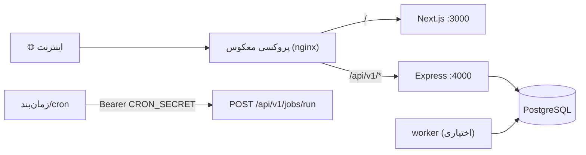

# فصل ۷ — استقرار

> **یک‌خطی:** استقرار استاندارد روی Node.js است: ساخت خروجی، اجرای سه فرآیند (api/web/worker) پشت یک پروکسی معکوس، و پشتیبان‌گیری دوره‌ای از PostgreSQL و پوشه `storage`.

📍 بازگشت به [فهرست مطالب](./README.md)

---

## ۷.۱ روش‌های دیپلوی



### روش ۱ — اجرای مستقیم با Node (پیشنهادی)

```bash
npm ci --include=dev        # نصب دقیق بر پایه lockfile (وابستگی توسعه لازم است برای build)
npm run build               # ساخت api و web
npx prisma migrate deploy   # اعمال مهاجرت‌ها بدون بازنشانی داده
npm run db:seed             # فقط بار اول (نقش‌ها/دسترسی‌ها/داده پایه)

npm run start:api           # :4000
npm run start:web           # :3000
npm run worker              # (اختیاری) پردازش پس‌زمینه
```

### روش ۲ — مدیریت فرآیند با systemd

```ini
# /etc/systemd/system/pe-api.service — نمونه واحد سرویس برای API
[Service]
WorkingDirectory=/opt/performance-evaluation
EnvironmentFile=/opt/performance-evaluation/.env
ExecStart=/usr/bin/npm run start:api
Restart=always
User=pe
```

### ⚠️ نکات حساس استقرار

- **`NODE_ENV=production` + وابستگی توسعه:** برای `build` به devDependencies نیاز دارید → `npm ci --include=dev`، سپس در اجرا نیازی نیست.
- **`.next` مشترک:** `next build` و `next dev` نباید هم‌زمان روی یک پوشه اجرا شوند.
- **پورت‌های اشغال‌شده:** پیش از restart، فرآیندهای `next`/`node` قبلی را ببندید (فصل ۸).
- **مهاجرت پیش از اجرا:** همیشه `prisma migrate deploy` قبل از بالا آوردن نسخه جدید.

---

## ۷.۲ زیرساخت و پروکسی معکوس

```nginx
# /etc/nginx/sites-available/performance-evaluation — پروکسی معکوس و TLS
server {
  listen 443 ssl http2;
  server_name pe.example.com;

  # TLS: گواهی معتبر (Let's Encrypt یا سازمانی)
  ssl_certificate     /etc/letsencrypt/live/pe.example.com/fullchain.pem;
  ssl_certificate_key /etc/letsencrypt/live/pe.example.com/privkey.pem;

  location /api/ { proxy_pass http://127.0.0.1:4000; proxy_set_header X-Forwarded-Proto $scheme; }
  location /     { proxy_pass http://127.0.0.1:3000; proxy_set_header X-Forwarded-Proto $scheme; }
}
```

| نیازمندی زیرساخت | توضیح |
|---|---|
| PostgreSQL ۱۴+ | ترجیحاً با `UTF-8` و `Locale fa-IR` |
| فضای دیسک | لوگ‌ها + `storage/` برای خروجی‌های اکسل |
| TLS | الزامی؛ در تولید کوکی **secure** است و بدون HTTPS کار نمی‌کند |
| پشتیبان آنلاین | snapshot روزانه از پایگاه‌داده |

> 📌 مرورگر فقط با مبدأ سایت حرف می‌زند؛ `/api/v1/*` یا با `rewrites` Next و یا با همین پروکسی معکوس به Express می‌رسد (کوکی same-site می‌ماند).

---

## ۷.۳ مانیتورینگ و لاگینگ

| موضوع | ابزار/مسیر |
|---|---|
| سلامت سرویس | `GET /api/v1/health` → `{ status, database, time, version }` |
| لاگ ساختاریافته | `pino` / `pino-http` (JSON؛ بدون داده حساس) |
| درخواست‌های کند | هدر زمان پاسخ + لاگ سطح `warn` |
| صف | `GET /api/v1/jobs` (وضعیت pending/running/dead) |
| امنیت | `GET /api/v1/admin/security/overview` + بستن نشست فعال |
| حسابرسی | `GET /api/v1/admin/audit` (رویدادها با کنشگر/موجودیت) |

```bash
# بررسی سلامت در استقرار (مثالی برای probe/مانیتورینگ)
curl -fsS https://pe.example.com/api/v1/health | grep -q '"status":"ok"' || echo "آژیر: سرویس ناسالم"
```

> ⚠️ پاک‌سازی لاگ حسابرسی با `DELETE /admin/audit/clear?days=30` خودش هم ثبت می‌شود — برای مهار رشد داده، نه پنهان‌کاری.

---

## ۷.۴ پشتیبان‌گیری و بازیابی

```bash
# پشتیبان منطقی از پایگاه‌داده (قالب سفارشی، فشرده)
pg_dump -h 127.0.0.1 -p 55433 -U postgres -Fc performance_evaluation > backup_$(date +%F).dump

# بازیابی
pg_restore -h 127.0.0.1 -p 55433 -U postgres -d performance_evaluation --clean backup_2026-10-15.dump

# پشتیبان پوشه فایل‌های خروجی
tar -czf storage_$(date +%F).tgz storage/
```

| سیاست پیشنهادی | مقدار |
|---|---|
| تکرار پشتیبان کامل | روزانه |
| نگهداری | ۳۰ روز (یا مطابق سیاست سازمان — `[REQUIRES BUSINESS CONFIRMATION]`) |
| آزمون بازیابی | ماهانه روی محیط آزمایشی |
| رمزنگاری نسخه پشتیبان | الزامی (داده‌های پرسنلی) |

> ⚠️ «آزمون‌نشده = نامعتبر»: تا زمانی که یک بازیابی واقعی را تمرین نکرده‌اید، پشتیبان را قابل‌اتکا ندانید.
> 🔧 `.pgdata` و `storage/` هر دو باید در پشتیبان باشند (اولی داده، دومی فایل‌های خروجی).

---

## 🧾 خلاصه فصل

استقرار = ساخت + مهاجرت + سه فرآیند پشت پروکسی معکوس با TLS، به‌همراه پایش سلامت/لاگ/صف و پشتیبان‌گیری دوره‌ای از پایگاه‌داده و `storage`.

⬅️ [فصل ۶ — پیکربندی](./06-config.md) · ➡️ [فصل ۸ — عیب‌یابی](./08-troubleshooting.md)
