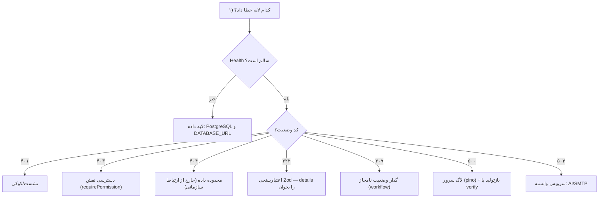

# فصل ۸ — عیب‌یابی و پرسش‌های متداول

> **یک‌خطی:** از خطاهای رایج این مخزن (Prisma، پایگاه‌داده، پورت‌ها، `NODE_ENV`، Service Worker) تا پرسش‌های متداول و روش نظام‌مند ردیابی مشکل.

📍 بازگشت به [فهرست مطالب](./README.md)

---

## ۸.۱ خطاهای رایج و راه‌حل

| نشانه | علت ریشه‌ای | راه‌حل |
|---|---|---|
| `The requested module '@prisma/client' does not provide an export named 'PrismaClient'` | کلاینت Prisma تولید نشده | `npx prisma generate` (یا `npm run dev` که خودش انجام می‌دهد) |
| `P1001: Can't reach database server at 127.0.0.1:55433` | پایگاه‌داده بالا نیست | `pg_ctl start` روی `.pgdata` با پورت ۵۵۴۳۳ |
| `npm install` وابستگی‌های توسعه را نصب نمی‌کند | `NODE_ENV=production` سراسری | `npm install --include=dev` |
| `next dev` رفتار تولیدی/کوکی نادرست | `NODE_ENV` ارث‌بری‌شده | `apps/web/scripts/dev.cjs` را اجرا کنید (`npm run dev:web`) |
| `500` روی همه صفحات در توسعه | همان تله `NODE_ENV` | بالا |
| پورت ۳۰۰۰ اشغال و محتوای قدیمی | فرآیند `next` یتیم با `.next` حذف‌شده | فرآیندهای قبلی را ببندید و دوباره اجرا کنید |
| صفحه‌ها خالی/قدیمی و خطای کلاینت | Service Worker قدیمی که `/_next` را کش کرده | Hard reload (Ctrl+Shift+R) — SW فقط در تولید فعال است |
| خطای Hydration نام‌تطابق | تفاوت HTML سرور و کلاینت | `<body suppressHydrationWarning>` + SW فقط تولید |
| `Functions cannot be passed directly to Client Components` | پاس‌دادن تابع از RSC به کلاینت | کامپوننت ردیفی کلاینت بسازید (الگوی `UserRowActions`) |
| `403` روی درخواست تغییردهنده | نبود هدر CSRF | `/auth/csrf` را بگیرید و `x-csrf-token` بفرستید |
| داده‌ای «پیدا نشد» با `404` | خارج از محدوده دسترسی | مورد انتظار؛ برای دیدن همه به `employees.view_all` نیاز است |
| `429` هنگام ورود | محدودسازی نرخ | کمی صبر؛ ۸ تلاش در ۵ دقیقه |
| خروجی AI `503` | سرویس AI تنظیم نشده | آداپتور محلی/offline یا تنظیم کلید در پنل |
| خروجی اکسل خالی | صف درین نشده | `POST /jobs/run` با `CRON_SECRET` (یا `npm run worker`) |

```bash
# تشخیص سریع در یک نگاه
curl -s http://127.0.0.1:4000/api/v1/health        # سرویس و پایگاه‌داده
netstat -ano | findstr ":3000 :4000"               # اشغال پورت‌ها
"C:\Program Files\PostgreSQL\16\bin\pg_isready.exe" -h 127.0.0.1 -p 55433
```

---

## ۸.۲ پرسش‌های متداول (FAQ)

**۱. چرا `npm run dev` کار می‌کند ولی `npm run dev:servers` نه؟**
`dev` پیش‌از‌اجرا کلاینت Prisma را چک/تولید و پایگاه‌داده را بالا می‌آورد؛ `dev:servers` فقط سرورهاست.

**۲. چطور رمز مدیر را عوض کنم؟**
با حساب مدیر وارد شوید → پروفایل → تغییر رمز؛ یا `SEED_ADMIN_PASSWORD` را ست و seed کنید؛ یا مدیر از پنل «بازنشانی رمز» بزند (پیوند یک‌بارمصرف).

**۳. آیا داده‌ها به بیرون ارسال می‌شوند؟**
به‌طور پیش‌فرض نه. فقط اگر سرویس AI را فعال کنید و کلید بگذارید؛ آن هم بدون داده‌های شخصی.

**۴. چرا مدیر فقط بعضی کارکنان را می‌بیند؟**
دسترسی بر پایه رابطه سازمانی محدود شده؛ برای دید کامل به `employees.view_all` نیاز است.

**۵. می‌توانم یک پرسش را بعد از انتشار ویرایش کنم؟**
نه؛ باید **نسخه جدید** فرم بسازید تا نتایج تاریخی تغییر نکند.

**۶. خروجی اکسل کجاست؟**
در پوشه `storage/` (خارج از `public/`)؛ فقط از مسیر مجازدار و **منقضی‌شدنی** دانلود می‌شود.

**۷. تفاوت «مصداق ندارد» و «بی‌پاسخ» چیست؟**
N/A از مخرج امتیاز حذف می‌شود؛ بی‌پاسخ هم حذف می‌شود اما ارسال نهایی را (برای پرسش الزامی) **مسدود** می‌کند.

**۸. چرا امتیاز نهایی با میانگین ساده فرق دارد؟**
چون میانگین **وزنی** است (وزن پرسش/بخش/ارزیاب) و وزن ارزیاب غایب **بازتوزیع نمی‌شود**.

**۹. چطور صف را در تولید اجرا کنم؟**
یک ورکر (`npm run worker`) یا یک cron که `POST /api/v1/jobs/run` را با `CRON_SECRET` صدا بزند.

**۱۰. رنگ‌ها در حالت تاریک ناخوانا شده‌اند؛ کجا درست کنم؟**
توکن‌های تم در `globals.css` و `dark:` در `packages/ui` و کامپوننت‌ها؛ کنتراست باید مطابق [فصل ۹](./09-contributing.md) حفظ شود.

**۱۱. آیا Docker لازم است؟**
نه. مسیر استاندارد Node.js است؛ نیازی به کانتینر نیست.

**۱۲. چطور یک محیط تازه بسازم؟**
پایگاه‌داده جدید بسازید → `.env` جدید با `DATABASE_URL`/`APP_KEY` تازه → `npm run setup`.

---

## ۸.۳ روش دیباگ و ردیابی مشکل



**ابزارهای درون‌مخزن:**

| ابزار | کاربرد |
|---|---|
| `npm run verify` | ۷۴ بررسی سرتاسری؛ سریع‌ترین راه بازتولید باگ دامنه |
| `npm test` | ۲۲ تست واحد روی هسته خالص (امتیاز/فرمول) |
| `npm run check` | اجرای typecheck + lint + test با هم |
| `GET /admin/audit` | «چه کسی چه چیزی را تغییر داد» |
| `npm run db:studio` | مرور داده با Prisma Studio |

> 💡 **قاعده:** باگ را ابتدا در `verify` بازتولید کنید، سپس اصلاح، سپس تأیید مجدد — این چرخه از «راستی‌آزمایی حدسی» جلوگیری می‌کند.
> ⚠️ هرگز برای گذر از خطا، محافظ‌ها (`--no-verify`، غیرفعال‌کردن CSRF، بازکردن محدوده) را دور نزنید.

---

## 🧾 خلاصه فصل

بیشتر خطاهای این پروژه ریشه‌ی «کلاینت Prisma تولیدنشده» یا «تله `NODE_ENV`» یا «پایگاه‌داده خاموش» دارند؛ با `health` + `verify` می‌توان سریع لایه خطا را قطعی کرد.

⬅️ [فصل ۷ — استقرار](./07-deployment.md) · ➡️ [فصل ۹ — مشارکت و توسعه](./09-contributing.md)
