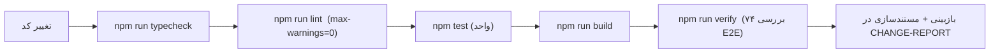

# فصل ۹ — مشارکت و توسعه

> **یک‌خطی:** قواعد کدنویسی، چرخه تست/بازبینی و دستور کار گام‌به‌گام برای افزودن یک ماژول، اندپوینت، صفحه یا مهاجرت جدید.

📍 بازگشت به [فهرست مطالب](./README.md)

---

## ۹.۱ قواعد کدنویسی و استایل

| قاعده | جزئیات |
|---|---|
| زبان کد | TypeScript با `strict`؛ از `any` پرهیز کنید |
| کامنت‌ها | به **انگلیسی** و فقط برای «چرا»، نه «چه» (کد باید گویا باشد) |
| متن رابط کاربری | فارسی و RTL؛ رشته‌ها در کامپوننت/اعداد via `lib/format.ts` |
| واردسازی | مسیر نسبی در بک‌اند و الیاس `@/` در وب |
| قالب‌بندی | ۲ فاصله، نقطه‌ویرگول، تک‌کوتیشن |
| نام‌گذاری | فایل‌ها `kebab`/`camel`، مدل‌های Prisma `PascalCase`، جدول‌ها `snake_case` با `@@map` |
| دسترسی | هر مسیر **باید** `requirePermission` داشته باشد |
| سازمان | از نشست؛ هرگز از `body`/`query` |
| اعتبارسنجی | هر ورودی با Zod در `packages/validation` |
| اعداد مالی/امتیاز | `decimal.js` / `Prisma.Decimal`؛ هرگز `number` شناور |

```ts
// الگوی درست یک اندپوینت جدید (با توضیح فارسی)
thingsRouter.post(
  '/',
  requirePermission('things.manage'),          // ۱) مجوز صریح
  validateBody(thingSchema),                   // ۲) اعتبارسنجی Zod
  asyncHandler(async (req, res) => {
    const auth = getAuth(req);
    const orgId = requireOrganization(auth);   // ۳) سازمان از نشست
    const row = await db.thing.create({ data: { organizationId: orgId, /* … */ } });
    await recordAudit({ organizationId: orgId, actorUserId: auth.id, action: 'thing.created', entityType: 'thing', entityId: row.id }, req); // ۴) حسابرسی
    sendData(res, { id: row.id }, 201);        // ۵) پاسخ پوشش‌دار
  }),
);
```

> ⚠️ از نوع‌های `any` و `as` بی‌دلیل پرهیز کنید؛ `npm run typecheck` باید بدون خطا بگذرد.
> 💡 برای هر «قاعده کسب‌وکار»، اول تست بنویسید (هسته خالص) بعد UI.

---

## ۹.۲ فرآیند تست و بازبینی



| سطح تست | محل | چه چیزی را پوشش می‌دهد |
|---|---|---|
| واحد | `tests/unit/*.test.ts` | موتور امتیازدهی (۱۵) و ارزیاب فرمول (۷) |
| سرتاسری | `scripts/verify.cjs` | ۷۴ سناریوی HTTP: ورود، RBAC، چرخه، انتشار، خروجی، تیکت، فرایند، توافق‌نامه، مجوز خروجی پاسخ‌ها |
| دستی | مرورگر | ظاهر/RTL/تاریک، تور راهنما، PWA |

```bash
npm run check      # typecheck + lint + test
npm run verify     # پس از بالا آوردن API
```

> 📌 **قاعده بازبینی:** هر تغییر دامنه باید یک بررسی تازه در `verify.cjs` بیفزاید یا یک تست واحد؛ در غیر این صورت «تأییدنشده» است.

---

## ۹.۳ دستور کار: افزودن یک قابلیت جدید

**گام ۱ — داده:** مدل را در `database/schema.prisma` اضافه کنید، سپس:

```bash
npx prisma migrate dev --name add_things    # مهاجرت + تولید کلاینت
```

**گام ۲ — دسترسی:** نام دسترسی جدید را در `packages/shared/src/permissions.ts` و نقش‌های مربوطه را در `roles.ts` اضافه کنید، سپس `npm run db:seed` (نقش‌ها همگام می‌شوند).

**گام ۳ — اعتبارسنجی:** اسکیما را در `packages/validation/src/<domain>.ts` بنویسید و از `index.ts` صادر کنید.

**گام ۴ — ماژول API:** `apps/api/src/modules/<domain>/routes.ts` را بسازید و در `apps/api/src/app.ts` سوار کنید: `api.use('/things', thingsRouter)`.

**گام ۵ — همراهی دامنه (اگر لازم است):** منطق خالص را در `packages/shared` بگذارید (مثل `scoring.ts`/`formula.ts`) تا قابل تست باشد.

**گام ۶ — UI:** صفحه در `apps/web/src/app/(app)/<مسیر>/page.tsx` + فرم کلاینت در `components/`؛ مورد را به `Shell.tsx` (منو با `permission`) اضافه کنید.

**گام ۷ — تست و مستند:** تست واحد/E2E بیفزایید و تغییر را در `docs/CHANGE-REPORT.md` ثبت کنید.

> ⚠️ فراموش‌کردن گام ۲ یا ۷، شایع‌ترین دلیل «کار می‌کند ولی در محیط دیگر ۴۰۳ می‌دهد» یا «کسی نمی‌داند چه شد» است.

---

## 🧾 خلاصه فصل

کد تایپ‌ایمن و فارسی، مجوز و اعتبارسنجی در هر مسیر، مهاجرت نسخه‌دار، و چرخه اجباری typecheck → lint → test → verify؛ فصل آخر تاریخچه و مسیر آینده را جمع‌بندی می‌کند.

⬅️ [فصل ۸ — عیب‌یابی](./08-troubleshooting.md) · ➡️ [فصل ۱۰ — تاریخچه و نقشه راه](./10-changelog.md)
