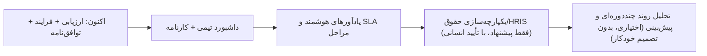

# فصل ۱۰ — تاریخچه و نقشه راه

> **یک‌خطی:** نسخه فعلی `0.1.0` است؛ شش جلسه توسعه‌ی مستندشده در `docs/CHANGE-REPORT.md` ثبت شده و نقشه راه شامل رفع شکاف‌های صریحاً اعلام‌شده است.

📍 بازگشت به [فهرست مطالب](./README.md)

---

## ۱۰.۱ نسخه‌بندی

| مورد | مقدار |
|---|---|
| نسخه پروژه | `0.1.0` (`package.json`، ریشه) |
| مدل‌های داده | ۶۳ |
| مهاجرت‌ها | ۳ (`database/migrations/`) |
| دسترسی‌ها / نقش‌ها | ۷۳ / ۵ |
| ماژول‌های API | ۱۹ |
| صفحات وب | ۳۴ |
| تست‌ها | ۲۲ واحد + ۷۴ بررسی سرتاسری |

**سیاست نسخه‌بندی (پیشنهادی):** `MAJOR` برای تغییر ناسازگار در مدل/قرارداد API، `MINOR` برای قابلیت جدید، `PATCH` برای اصلاح. هر تغییر داده = یک مهاجرت با نام گویا.

> 🔧 تا نسخه `1.0.0`، قراردادهای API و اسکیمای داده ممکن است تغییر کنند؛ نسخه‌های قبلی نتایج ارزیابی تغییرناپذیر می‌مانند (سیاست نسخه‌گذاری فرم).

---

## ۱۰.۲ تغییرات اعمال‌شده

خلاصه شش جلسه (جزئیات کامل در `docs/CHANGE-REPORT.md`):

| جلسه | محور کار |
|---|---|
| ۱ | پایه سامانه: مونوریپو، مدل داده، موتور امتیازدهی، احراز هویت/RBAC، چرخه ارزیابی، خروجی اکسل، مستندات انطباق |
| ۲ | ۱۴ قابلیت: دپارتمان کاربر، نقش/واحد/سمت قابل‌ویرایش، تم روشن/تاریک، پیام و تیکت، نمودارها، صفحه فرود، PWA، تور آموزشی، تاریخ شمسی، ویزارد فرم/دوره، برنامه بهبود، پیشنهاد پاداش |
| ۳ | اصلاح تجربه کاربری: باگ Hydration، Service Worker مزاحم، صفحه فرود، حذف فایل‌های batch |
| ۴ | اصلاح هدر/کناره، به‌روزرسانی نام سازمان در هدر، رفع خطای «کاربران» و «بانک پرسش»، ویزارد، ادغام منو، پاک‌سازی Event Logs، صفحه‌بندی/بارگذاری AJAX، انیمیشن |
| ۵ | اجرای ساده‌ی پروژه: `scripts/dev.cjs` خودترمیم (تولید Prisma + راه‌اندازی پایگاه‌داده + مهاجرت)، رفع باگ دیتچ |
| ۶ | حذف نقش/واحد/سمت/کاربر + بازنشانی رمز، نمودار نتایج به‌تفکیک فرد/واحد/سمت، خروجی پاسخ‌ها برای مدیر ارشد، و ماژول‌های **فرایند**، **توافق‌نامه**، **زمان‌بندی دوره**، **شاخص محاسباتی** و صفحه **«عملکرد من»** |

> 📌 همه تغییرات جلسه ۶ با **۷۴/۷۴** بررسی سرتاسری، **۲۲/۲۲** تست واحد، lint بدون هشدار و build موفق تأیید شده‌اند.

---

## ۱۰.۳ برنامه آینده (نقشه راه)

**شکاف‌های صریحاً اعلام‌شده (درست‌ترین اولویت):**

| مورد | وضعیت فعلی | گام بعدی |
|---|---|---|
| داشبورد «عملکرد تیم» مدیر | فعلاً کاشی‌های داشبورد + صفحه نتایج | صفحه اختصاصی مقایسه تیمی با نمودار |
| صفحه «کارنامه دوره» مستقل | صفحه نتایج نقش آن را دارد | صفحه کارنامه با تفکیک بخش/پرسش |
| ویرایشگر فرمول در Form Builder | API `computed`/`formula` را می‌پذیرد | UI ویرایش فرمول با اعتبارسنجی زنده |
| آیکون‌های PWA (maskable PNG) | آیکون SVG | تولید مجموعه PNG ۱۹۲/۵۱۲ |
| اسکن خودکار دسترس‌پذیری (axe) | بازبینی دستی | افزودن axe در CI |
| ویرایش خودکار وابستگی‌ها | `npm audit` بررسی‌شده | به‌روزرسانی برنامه‌ریزی‌شده |
| اسکن آنتی‌ویروس آپلودها | ندارد | اتصال به سرویس اسکن سازمانی |
| سرویس GapGPT | آداپتور قابل‌پیکربندی، **endpoint تأییدنشده** | دریافت مستندات/کلید واقعی و آزمون اتصال |
| اطلاعات هویتی کسب‌وکار | `[REQUIRES BUSINESS CONFIRMATION]` | تکمیل توسط سازمان پیش از تولید |

**قابلیت‌های پیشنهادی (نیازمند تصمیم کسب‌وکار):**

> ⚠️ **اصول تغییرناپذیر:** هوش مصنوعی هرگز تصمیم استخدامی/حقوقی نمی‌گیرد؛ هیچ اجرای خودکار پرداخت وجود ندارد؛ و هر ادعای انطباق/امنیت تنها پس از آزمون واقعی قابل طرح است.
> 💡 برای هر قابلیت جدید، همان چرخه فصل ۹ (مدل → دسترسی → اعتبارسنجی → ماژول → تست → مستند) را دنبال کنید.

---

## 🧾 خلاصه فصل

نسخه `0.1.0` با ۶۳ مدل، ۱۹ ماژول و ۷۴ بررسی سرتاسری، در شش جلسه ساخته و مستند شده؛ اولویت‌های بعدی، پرکردن شکاف‌های اعلام‌شده (داشبورد تیمی، کارنامه، ویرایشگر فرمول، PWA/DNS، انطباق) است.

⬅️ [فصل ۹ — مشارکت](./09-contributing.md) · 🏠 [فهرست مطالب](./README.md)
